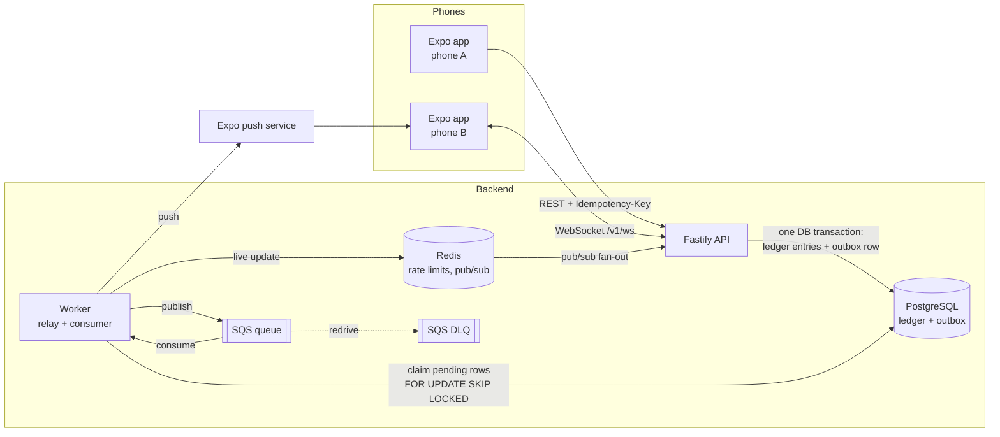

# Pay Wallet

A production-style mobile wallet for South African rand. Hold a ZAR balance, send money by contact or QR code, request money, and watch your balance update live. Every send is confirmed with Face ID or fingerprint.

The interesting part is the backend: balances come from a **double-entry ledger**, transfers are **idempotent** and **can't overdraw even when they run at the same time**, and side effects go through a **transactional outbox** to a queue, with retries, a dead-letter view and a safe **replay**.

> **Demo:** two phones. Phone A scans phone B's QR code and sends R250 with Face ID. Phone B's balance updates live and it gets a push notification.

## Status

| Area                                                         | State        |
| ------------------------------------------------------------ | ------------ |
| Ledger, transfers, top-ups, payment requests, limits, freeze | Done, tested |
| Outbox relay, worker, retries, dead letters, replay          | Done, tested |
| WebSocket live updates, Expo push sender                     | Done, tested |
| Expo app (React Native)                                      | In progress  |
| AWS CDK stack, CI workflow, ADRs                             | In progress  |

## Architecture



1. The API posts a transfer in **one database transaction**: it inserts the transaction, writes a debit and a credit, updates both balance projections, and writes an **outbox event**.
2. The worker's **relay** claims pending outbox rows and publishes them to SQS. If SQS is down, the rows wait in Postgres, so nothing is lost.
3. The worker's **consumer** sends the WebSocket update (through Redis pub/sub, so any API instance can deliver it) and the push notification. Each side effect is recorded in `processed_events`, so a duplicate delivery or a replay never repeats it.
4. After 5 failed attempts with exponential backoff, the event is marked **dead**. Admins see it in the app and can replay it.

## Design decisions

**Double-entry ledger.** Every movement writes exactly one debit and one credit for the same amount. Top-ups debit a `CARD_FUNDING` system account, so they balance too. `ledger_entries` is append-only: a database trigger rejects `UPDATE` and `DELETE`.

**Balance as a projection.** `accounts.balance_cents` is written only by the posting service, in the same transaction as the ledger entries. A reconciliation check (`packages/db/src/reconcile.ts`) proves that every projection equals its ledger sum and every transaction balances. It runs after **every integration test** and is available to admins at `GET /v1/admin/reconciliation`.

**Concurrency: ordered `FOR NO KEY UPDATE` locks.** Both accounts are locked in ascending ID order, so A→B and B→A running at once can't deadlock. The balance, frozen and daily-limit checks run while the locks are held, so concurrent requests can't race past them. The lock is `FOR NO KEY UPDATE`, not `FOR UPDATE`. Inserting the transaction row takes `FOR KEY SHARE` on both accounts through its foreign keys, and `FOR UPDATE` conflicts with that share lock, so two concurrent postings deadlock. The test suite found this. `FOR NO KEY UPDATE` still excludes other postings.

**Idempotency.** Every money-moving endpoint requires an `Idempotency-Key`, unique per user (`UNIQUE (user_id, idempotency_key)`):

- **Same key and same body:** you get the original result back. The response has an `idempotent-replayed: true` header, and the account is never debited a second time.
- **Same key and a different body:** `422 IDEMPOTENCY_KEY_REUSED`.
- **Same key arriving concurrently:** the unique index makes the second insert wait for the first to commit, and then it returns the first result.
- **Failures:** business failures (insufficient funds, limit, frozen) are stored on the transaction. A retry returns the same failure instead of trying again.

The app keeps one key per user action and reuses it when retrying after a network error.

**Outbox and at-least-once delivery.** The outbox row commits with the money, so an event can't be lost or sent for a transfer that rolled back. Delivery is at-least-once, and the consumer de-duplicates per event and per side effect. It inserts the `processed_events` row first, inside a transaction that stays open while the side effect runs. A concurrent duplicate blocks on the primary key and then skips. If the side effect fails, the row rolls back and the retry runs it again.

**One place for dead letters.** The worker marks events `dead` in the outbox table, which is what the admin screen reads. The SQS DLQ is only a safety net for messages the worker couldn't parse, and those are written back to the outbox as dead too.

**Daily limit.** R5 000 per calendar day in Africa/Johannesburg time. Transfers and request payments count towards it; top-ups don't.

## Running locally

Requirements: Node 20+, pnpm 10, Docker.

```bash
pnpm install
docker compose up -d          # Postgres, Redis, LocalStack (SQS)
pnpm db:migrate
pnpm db:seed                  # demo users and a few hundred transactions
pnpm dev:backend              # API on :3000, worker
```

- API docs (OpenAPI generated from the Zod schemas): http://localhost:3000/docs
- No LocalStack? Run the worker with `QUEUE_DRIVER=memory`.

### Demo logins

The password for all of them is `Demo1234!`.

| User                          | Email             |
| ----------------------------- | ----------------- |
| Thandi Nkosi (wallet holder)  | thandi@demo.co.za |
| Sipho Dlamini (wallet holder) | sipho@demo.co.za  |
| Operations (admin)            | ops@demo.co.za    |

### Forcing a dead letter for the demo

```bash
WORKER_FAIL_EVENT_TYPES=transfer.completed pnpm --filter @wallet/worker dev
# send money: after 5 attempts the event shows in Admin → Dead letters
# restart the worker without the variable, then press Replay: exactly one notification arrives
```

## Tests

```bash
pnpm test
```

The integration tests run against a real Postgres and Redis. They include:

- 50 concurrent transfers from one account, which never overdraw it
- 25 A→B and 25 B→A transfers at once, with no deadlocks
- 20 concurrent sends that together can't exceed the daily limit
- the same `Idempotency-Key` fired 10 times at once, which produces exactly one posting
- a request paid concurrently with different keys, which is paid once
- a freeze racing in-flight transfers
- retries, backoff, dead-lettering, and a replay that produces no duplicate push
- the full demo flow end to end: API, worker, WebSocket and push

### Performance

With 10,000 seeded transactions, run the latency check:

```bash
SEED_TRANSACTIONS=10000 pnpm db:seed
pnpm --filter @wallet/api bench
```

The target is p95 under 200 ms. Locally it measures about 10 ms for creating a transfer and about 6 ms for a page of history.

## Repo layout

```
apps/api        Fastify API: auth, wallet, transfers, payment requests, admin, WebSocket
apps/worker     Outbox relay, SQS consumer, push sender, dead letters
apps/mobile     Expo app (React Native)
packages/shared Zod schemas, money helpers, QR receive-code format (shared by app and API)
packages/db     Drizzle schema, migrations, reconciliation
infra           AWS CDK: ECS Fargate, RDS, ElastiCache, SQS + DLQ
docs/decisions  ADRs
```

## Licence

MIT
